# Bài 7

Mã sinh viên: 202418989
Họ tên: Chu Đình Thi

## Link phiên làm việc AI
https://share.gemini.google/0KByAM9PCE0X

## Phân tích và thiết kế

### A. Mô tả các class và interface

#### 1. Interface IIdentifiable

- Trách nhiệm: Định nghĩa giao ước nhận diện chung cho mọi đối tượng trong hệ thống thông qua mã định danh.
- Thuộc tính: `Id` (chuỗi định danh chỉ đọc).
- Quan hệ: Làm kiểu cơ sở và là generic constraint (`where T : IIdentifiable`) cho kho lưu trữ tổng quát.

#### 2. Enum DeviceStatus

- Trách nhiệm: Định nghĩa các trạng thái hoạt động của thiết bị trong hệ thống.
- Giá trị: `Available` (sẵn sàng), `Borrowed` (đang mượn), `UnderMaintenance` (đang bảo trì).

#### 3. Lớp trừu tượng TeachingDevice

- Trách nhiệm: Lớp cơ sở trừu tượng cho mọi thiết bị phục vụ giảng dạy, quản lý thông tin chung và điều khiển quy trình mượn/trả.
- Thuộc tính: `Id`, `Name`, `StorageLocation`, `Status` (chỉ cho phép lớp con thay đổi qua `protected set`).
- Constructor: Nhận 3 tham số (`id`, `name`, `storageLocation`), kiểm tra hợp lệ ko đc để trống, đặt trạng thái ban đầu là `Available`.
- Phương thức:
  + `IsReadyForUse()`: Phương thức trừu tượng kiểm tra thiết bị có đủ điều kiện sẵn sàng hay ko.
  + `GetDefaultPriorityScore()`: Phương thức trừu tượng tính điểm ưu tiên cấp phát.
  + `Borrow()`: Đổi trạng thái sang `Borrowed` nếu `IsReadyForUse()` trả về true.
  + `Return()`: Đổi trạng thái về `Available` nếu đang ở trạng thái `Borrowed`.
- Quan hệ: Kế thừa và thực thi `IIdentifiable`, làm lớp cha cho các loại thiết bị cụ thể.

#### 4. Lớp ProjectorRemote

- Trách nhiệm: Quản lý thiết bị điều khiển máy chiếu phòng học.
- Thuộc tính: `BatteryLevel` (mức pin từ 0 đến 100).
- Constructor: Nhận mã, tên, vị trí lưu trữ và mức pin (kiểm tra pin từ 0 đến 100).
- Phương thức:
  + Override `IsReadyForUse()`: Sẵn sàng khi trạng thái là `Available` và `BatteryLevel >= 20`.
  + Override `GetDefaultPriorityScore()`: Điểm ưu tiên bằng chính mức pin (`BatteryLevel`).
- Quan hệ: Kế thừa từ `TeachingDevice`.

#### 5. Lớp AirConditionerRemote

- Trách nhiệm: Quản lý thiết bị điều khiển điều hòa tại các phòng học.
- Thuộc tính: `CompatibleRooms` (tập danh sách mã phòng tương thích `IReadOnlySet<string>`).
- Constructor: Nhận mã, tên, vị trí và danh sách phòng tương thích.
- Phương thức:
  + `IsCompatibleWith(string roomId)`: Kiểm tra thiết bị có tương thích vs mã phòng yêu cầu hay ko.
  + Override `IsReadyForUse()`: Sẵn sàng khi trạng thái là `Available`.
  + Override `GetDefaultPriorityScore()`: Mặc định bằng 100 nếu tương thích.
- Quan hệ: Kế thừa từ `TeachingDevice`.

#### 6. Lớp WirelessMicrophone

- Trách nhiệm: Quản lý thiết bị micro không dây giảng dạy.
- Thuộc tính: `BatteryLevel` (mức pin 0-100) và `SignalQuality` (chất lượng tín hiệu 0-100).
- Constructor: Nhận mã, tên, vị trí, pin và chất lượng tín hiệu.
- Phương thức:
  + Override `IsReadyForUse()`: Sẵn sàng khi trạng thái là `Available`, `BatteryLevel >= 30` và `SignalQuality >= 40`.
  + Override `GetDefaultPriorityScore()`: Điểm ưu tiên tính bằng trung bình cộng `(BatteryLevel + SignalQuality) / 2.0`.
- Quan hệ: Kế thừa từ `TeachingDevice`.

#### 7. Hệ thống Ngoại lệ (Exceptions)

- `DuplicateIdException`: Ném ra khi thêm 1 phần tử có mã `Id` đã tồn tại trong kho lưu trữ.
- `NoSuitableItemException`: Ném ra khi thuật toán hoặc dịch vụ cấp phát ko tìm đc bất kỳ thiết bị nào thỏa mãn điều kiện.
- `DeviceNotReadyException`: Ném ra khi cố gắng mượn (`Borrow()`) 1 thiết bị chưa đủ điều kiện sẵn sàng sử dụng.

#### 8. Interface và Lớp Kho lưu trữ tổng quát (Generic Repository)

- `IRepository<T> where T : IIdentifiable`: Interface quy định các thao tác lưu trữ chuẩn: `Add(item)`, `Remove(id)`, `FindById(id)`, `GetAll()`, `FindAll(predicate)`.
- `InMemoryRepository<T> : IRepository<T> where T : IIdentifiable`:
  + Lưu trữ dữ liệu nội bộ bằng cấu trúc `Dictionary<string, T>`.
  + Ngăn chặn phần tử null và mã trùng lặp (`DuplicateIdException`).
  + `GetAll()` trả về danh sách chỉ đọc (`AsReadOnly()`), ko làm lộ cấu trúc nội bộ ra bên ngoài.
  + Dễ dàng tái sử dụng cho mọi loại thiết bị mà ko cần viết lại code.

#### 9. Interface và Lớp Chiến lược lựa chọn (Strategy Pattern)

- `ISelectionStrategy<T>`: Interface chiến lược lựa chọn nhận vào ds ứng viên và trả về 1 đối tượng tốt nhất: `T Select(IReadOnlyList<T> candidates)`.
- `HighestPriorityStrategy<T>`: Chọn đối tượng có điểm số cao nhất dựa trên hàm ủy quyền `Func<T, double>` truyền từ ngoài vào.
- `FirstAvailableStrategy<T>`: Chọn đối tượng đầu tiên xuất hiện trong ds ứng viên.
- Cả hai chiến lược đều phát sinh ngoại lệ `NoSuitableItemException` nếu danh sách ứng viên rỗng.

#### 10. Lớp Dịch vụ cấp phát tổng quát (AllocationService)

- `AllocationService<T> where T : TeachingDevice`:
  + Quản lý quy trình cấp phát thiết bị tự động bằng cách kết hợp giữa `IRepository<T>` và `ISelectionStrategy<T>`.
  + Phương thức `ChangeStrategy(newStrategy)`: Cho phép thay đổi thuật toán lựa chọn ngay trong lúc chương trình đang chạy.
  + Phương thức `Allocate(additionalCondition)`: Tự động lọc các thiết bị sẵn sàng (`IsReadyForUse()`), kết hợp điều kiện bổ sung, chuyển cho chiến lược chọn thiết bị tối ưu và gọi `Borrow()` để chuyển trạng thái.

---

### B. Các bất biến của mô hình

- Mã thiết bị (`Id`), tên (`Name`) và vị trí lưu trữ (`StorageLocation`) ko đc để trống hoặc null.
- Trạng thái thiết bị khi mới khởi tạo luôn là `Available`.
- Mức pin (`BatteryLevel`) và chất lượng tín hiệu (`SignalQuality`) luôn nằm trong đoạn [0, 100].
- Thiết bị chỉ đc cấp phát hoặc mượn (`Borrow()`) khi phương thức `IsReadyForUse()` trả về true.
- Chỉ cho phép trả thiết bị (`Return()`) khi thiết bị đó đang ở trạng thái `Borrowed`.
- Kho lưu trữ (`InMemoryRepository<T>`) ko chấp nhận phần tử null và ko cho phép 2 phần tử có cùng mã `Id`.
- Dịch vụ cấp phát (`AllocationService<T>`) luôn bảo đảm sau khi cấp phát thành công thì thiết bị đc chọn phải chuyển trạng thái sang `Borrowed`.

---

### C. Giải thích thiết kế & trả lời câu hỏi định hướng

#### 1. Hành vi nào chung cho mọi thiết bị và nên nằm trong lớp cơ sở? Hành vi nào thay đổi theo loại thiết bị và nên được ghi đè?
- **Hành vi chung (nằm trong `TeachingDevice`)**: Lưu trữ định danh, tên, vị trí, trạng thái; kiểm tra tính hợp lệ cơ bản; quy trình mượn (`Borrow()`) và trả (`Return()`).
- **Hành vi thay đổi (ghi đè đa hình ở lớp con)**:
  + `IsReadyForUse()`: Điều hòa chỉ cần `Available`; máy chiếu yêu cầu thêm pin $\ge 20\%$; micro yêu cầu cả pin $\ge 30\%$ và tín hiệu $\ge 40\%$.
  + `GetDefaultPriorityScore()`: Máy chiếu lấy theo pin; điều hòa lấy điểm cố định 100; micro lấy điểm trung bình của pin và chất lượng sóng.

#### 2. Kho lưu trữ có cần biết thiết bị cụ thể là micro hay điều khiển không?
- Hoàn toàn **không cần**. Nhờ dùng Generic `IRepository<T> where T : IIdentifiable`, kho chỉ cần biết đối tượng có thuộc tính `Id` để quản lý thêm, xóa, tìm kiếm theo khóa. Điều này giúp loại bỏ hoàn toàn mã lặp, 1 lớp kho dùng đc cho mọi loại thiết bị hiện tại và tương lai.

#### 3. Nếu có nhiều cách chọn thiết bị tốt nhất, nên dùng chuỗi if/else hay một interface chiến lược?
- Nên sử dụng **Interface chiến lược (`ISelectionStrategy<T>`)** (Mẫu thiết kế Strategy Pattern).
- **Lý do**: Tránh đc chuỗi `if/else` cồng kềnh khó mở rộng, tuân thủ nguyên lý Single Responsibility (mỗi chiến lược phụ trách 1 thuật toán) và Open/Closed (thêm chiến lược mới ko cần sửa `AllocationService`). Đặc biệt còn cho phép tráo đổi chiến lược linh hoạt ngay tại thời gian chạy thông qua hàm `ChangeStrategy()`.

#### 4. Generic constraint nào giúp bảo đảm kho chỉ lưu các đối tượng có mã định danh? Nếu bỏ constraint, FindById() gặp khó khăn gì?
- Dùng generic constraint: `where T : IIdentifiable`.
- Nếu bỏ constraint này, trình biên dịch coi `T` là `object`, phương thức `FindById(string id)` sẽ ko thể truy cập vào thuộc tính `item.Id` để so sánh tìm kiếm mã. Khi đó buộc phải ép kiểu (`(IIdentifiable)item`) hoặc dùng reflection, làm mất an toàn kiểu tại thời điểm biên dịch và làm giảm hiệu năng.

#### 5. Nên sử dụng List<T> hay Dictionary<string, T> trong InMemoryRepository? Hãy nêu trade-off.
- **Quyết định**: Sử dụng `Dictionary<string, T>`.
- **Trade-off**:
  + `Dictionary<string, T>`: Tốc độ tìm kiếm (`FindById`) và kiểm tra trùng lặp (`ContainsKey`) đạt độ phức tạp $O(1)$, tối ưu hiệu năng vượt trội khi số lượng thiết bị lớn; nhược điểm là tốn thêm 1 chút bộ nhớ để lưu bảng băm (hash table).
  + `List<T>`: Tiết kiệm bộ nhớ hơn 1 chút nhưng thao tác tìm kiếm phải duyệt tuần tự $O(n)$, hiệu năng giảm dần khi kho có nhiều thiết bị.

#### 6. Vì sao không tạo ba lớp ProjectorRemoteRepository, AirConditionerRemoteRepository và MicrophoneRepository?
- Vì logic thêm, xóa, tìm kiếm theo Id, kiểm tra trùng lặp và lọc của cả 3 lớp này hoàn toàn giống hệt nhau.
- Nếu tạo 3 lớp riêng sẽ gây trùng lặp mã nguồn nghiêm trọng (vi phạm nguyên lý DRY - Don't Repeat Yourself). Khi cần sửa logic kho thì phải sửa ở cả 3 nơi, vừa tốn công vừa dễ sinh lỗi. Dùng Generic `InMemoryRepository<T>` giải quyết triệt để vấn đề này chỉ bằng 1 lớp duy nhất.

---

### D. Sơ đồ thiết kế (Class diagram)

```mermaid
classDiagram
    class IIdentifiable {
        <<interface>>
        +Id: string
    }

    class DeviceStatus {
        <<enumeration>>
        Available
        Borrowed
        UnderMaintenance
    }

    class TeachingDevice {
        <<abstract>>
        +Id: string
        +Name: string
        +StorageLocation: string
        +Status: DeviceStatus
        +IsReadyForUse()* bool
        +GetDefaultPriorityScore()* double
        +Borrow() void
        +Return() void
        +ToString() string
    }

    class ProjectorRemote {
        +BatteryLevel: int
        +IsReadyForUse() bool
        +GetDefaultPriorityScore() double
    }

    class AirConditionerRemote {
        +CompatibleRooms: IReadOnlySet~string~
        +IsCompatibleWith(roomId: string) bool
        +IsReadyForUse() bool
        +GetDefaultPriorityScore() double
    }

    class WirelessMicrophone {
        +BatteryLevel: int
        +SignalQuality: int
        +IsReadyForUse() bool
        +GetDefaultPriorityScore() double
    }

    class IRepository~T~ {
        <<interface>>
        +Add(item: T) void
        +Remove(id: string) bool
        +FindById(id: string) T
        +GetAll() IReadOnlyList~T~
        +FindAll(condition: Predicate~T~) IReadOnlyList~T~
    }

    class InMemoryRepository~T~ {
        -items: Dictionary~string, T~
        +Add(item: T) void
        +Remove(id: string) bool
        +FindById(id: string) T
        +GetAll() IReadOnlyList~T~
        +FindAll(condition: Predicate~T~) IReadOnlyList~T~
    }

    class ISelectionStrategy~T~ {
        <<interface>>
        +Select(candidates: IReadOnlyList~T~) T
    }

    class HighestPriorityStrategy~T~ {
        -scoreSelector: Func~T, double~
        +Select(candidates: IReadOnlyList~T~) T
    }

    class FirstAvailableStrategy~T~ {
        +Select(candidates: IReadOnlyList~T~) T
    }

    class AllocationService~T~ {
        -repository: IRepository~T~
        -strategy: ISelectionStrategy~T~
        +ChangeStrategy(newStrategy: ISelectionStrategy~T~) void
        +Allocate(additionalCondition: Predicate~T~) T
    }

    class DuplicateIdException {
        +DuplicateId: string
    }

    class NoSuitableItemException {
        +Message: string
    }

    class DeviceNotReadyException {
        +DeviceId: string
        +CurrentStatus: DeviceStatus
    }

    IIdentifiable <|.. TeachingDevice : Thực thi
    TeachingDevice <|-- ProjectorRemote : Kế thừa
    TeachingDevice <|-- AirConditionerRemote : Kế thừa
    TeachingDevice <|-- WirelessMicrophone : Kế thừa
    TeachingDevice --> DeviceStatus : Sử dụng

    IRepository~T~ <|.. InMemoryRepository~T~ : Thực thi
    ISelectionStrategy~T~ <|.. HighestPriorityStrategy~T~ : Thực thi
    ISelectionStrategy~T~ <|.. FirstAvailableStrategy~T~ : Thực thi

    AllocationService~T~ o-- IRepository~T~ : Phối hợp
    AllocationService~T~ o-- ISelectionStrategy~T~ : Phối hợp
```

---

### E. Ảnh chạy chương trình

